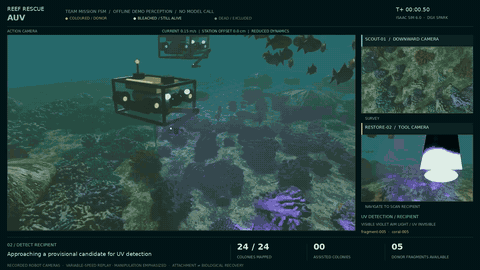
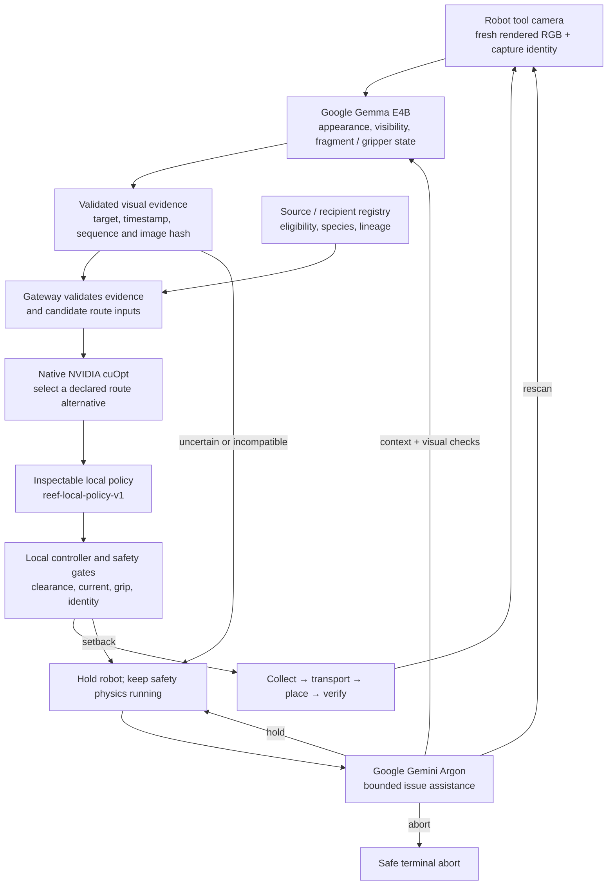

# Reef Rescue — Great Barrier Defenders

**A perception-guided coral-restoration robot that inspects before handling, preserves fragment identity, and stops when the evidence is uncertain.**

Reef Rescue explores how a robot can collect **registered, already-detached coral fragments**, carry them through a changing underwater scene, place them on eligible recipients and verify mechanical attachment. Google Gemma reads the robot camera; an inspectable policy checks the registry and evidence; NVIDIA cuOpt selects a route. When the robot is unsure, Google Gemini Argon supplies context and visual checks for Gemma’s next fresh assessment, alongside rescan, hold or abort advice. Local safety checks remain in control throughout.

[](docs/media/pipeline-video.mp4)

**[Watch the full pipeline video](docs/media/pipeline-video.mp4)** · [Interactive simulation](https://reef-rescue-auv-lab.harrish-ayyanar.chatgpt.site/lab/) · [Technical summary](docs/submission/technical-summary-current.pdf) · [Evidence](docs/EVIDENCE.md) · [Judging guide](docs/JUDGING_GUIDE.md)

The 59.6-second pipeline video follows the inspection, handling, transport and recovery sequence. The interactive deployment may require owner access; the local setup below is available from this repository. Run records, model receipts and tests are linked separately so each result can be checked against its source.

## The problem and the mission

Restoration teams need to inspect and handle fragile material in an environment where visibility, currents and access change. Diver time is limited, and an uncertain identification or lost fragment should not turn into an unrecorded intervention. Reef Rescue makes the decision chain inspectable: **what the robot saw, which stock was eligible, why it moved, and whether placement actually succeeded**.

Our scenario starts with a restoration team's registry of source stock and recipients. In the compact demonstration, one source and one recipient share a registered species and lineage; the mission goal is one verified placement. Other colonies remain habitat. The robot:

1. Selects compatible, accessible stock using the registry.
2. Inspects the recipient and the actual loose fragment through its tool camera; source eligibility stays in the independent registry.
3. Requires fresh Gemma evidence and a matching gripper state before handling.
4. Requests a route from the local policy and native cuOpt.
5. Collects the existing fragment and carries it under clearance, wildlife, current and grip checks.
6. If it loses the fragment, tracks the same ID and requires a fresh view before recovery.
7. Places it, verifies mechanical attachment, then records completion.

The mission collects existing loose stock and preserves healthy colonies. Gemma assesses visible appearance; the independent registry supplies biological eligibility, genotype and lineage. Simulated UV exposure supports inspection, and mechanical attachment is the completion criterion. [Scientific motivation and primary references](docs/JUDGING_GUIDE.md#relevance-scientific-motivation-and-intended-impact) explain the restoration workflow.

## System architecture



The current browser mission lives in **[`sim/pelagic`](sim/pelagic/README.md)**. Its Python gateway owns model credentials and validates provider responses. The browser owns mission progression and reduced physics. The separately displayed Isaac RTX camera/state feed is read-only; it is not the browser mission's actuator or contact engine.

| Layer | Implementation | Responsibility |
| --- | --- | --- |
| Camera and interaction | [scene.mjs](sim/pelagic/web/lab/scene.mjs), [app.mjs](sim/pelagic/web/lab/app.mjs) | Render the robot view, bind captures to targets, call services and display their actual responses. |
| Mission and local control | [simulation.mjs](sim/pelagic/web/lab/simulation.mjs) | Enforce fresh evidence, registry eligibility, motion, grip, identity, recovery and placement checks. |
| Gateway and policy | [lab_server.py](sim/pelagic/reefsim/lab_server.py) | Validate Gemma packets, apply the inspectable policy, call cuOpt and bound Argon assistance. |
| Hosted services | [modal_lab_backend.py](sim/pelagic/scripts/modal_lab_backend.py), [worker.mjs](sim/pelagic/sites/reef-lab/worker.mjs) | Serve GPU workloads and authenticated same-origin requests. |
| Edge services | [Edge deployment guide](docs/EDGE_DEPLOYMENT.md) | Run pinned Gemma weights on the Spark and preserve resource measurements. |
| Evidence and memory | [recorder.mjs](sim/pelagic/web/lab/recorder.mjs), [semantic-memory.mjs](sim/pelagic/web/lab/semantic-memory.mjs) | Export episodes and retain bounded observations without using old memory as fresh permission. |

[Detailed architecture and source map](docs/ARCHITECTURE.md) · [Service contracts](sim/pelagic/docs/ARCHITECTURE.md)

## Models, hardware and authority

| Component | Exact identity | Where it runs | What it may do |
| --- | --- | --- | --- |
| **Google Gemma** | Served `gemma-4-E4B-it`; weights `google/gemma-4-E4B-it` | Hosted vLLM on Modal; also measured locally on Spark GB10 | Describe visible appearance, target visibility and fragment/gripper state. |
| **Google Gemini Argon** | `gemini-4-argon` | Google Interactions API | Provide bounded context and visual checks for Gemma, plus `rescan`, `hold` or `abort`; review terminated episodes. |
| **NVIDIA cuOpt** | `nvidia-cuopt`; recorded native solver `26.10.0` | Modal or local Spark gateway | Select among supplied route alternatives using their costs. |
| **Local policy** | `reef-local-policy-v1` | Python gateway | Check registry and fresh evidence, then propose a permitted action and route. |
| **Local controller** | Mission state machine and reduced physics | Browser | Execute only locally valid motion and verify the outcome. |

**Gemma is used through Modal in the hosted pipeline, and local Gemma inference has now been measured on the Spark.** The edge measurement used official weights at revision `4ecc2ba63bcac23ba4a767fc87025b1450f84c9c` inside a container with external networking disabled. It completed five actual image requests. The [edge guide](docs/EDGE_DEPLOYMENT.md) records the pinned runtime, raw responses, resource counters and reproducible commands.

Argon’s contextual advice is bound to the episode and target, expires after 60 simulated seconds and accompanies a new image. Gemma independently evaluates that image; the registry, freshness checks and local safety gates determine handling permission. Assistance has three attempts per episode, a 25-second socket timeout and a 90-second active hold limit. Transient failures and HOLD responses trigger bounded automatic rechecks; permanent invalid responses never become permission to move. Credentials remain server-side.

The root Python research stack is a separate implementation path. It defaults to `gemma-4-31b-it`; its optional cloud perception uses `gemini-3.5-flash-lite`, and synthetic fixture generation uses `gemini-nano-banana-2.1`. These are not extra models in the saved browser mission. [Model-to-source map](docs/ARCHITECTURE.md#separate-python-research-components).

## What has been verified

The [saved complete hosted episode](docs/evidence/live-model-episode.json), exported on **8 November 2026 at 13:41:14 UTC**, contains one mechanically verified placement in **80.55 simulated seconds**, with zero collisions, drops or recoveries. Five Gemma replies, an actual Argon-assisted rescan, a camera-dropout hold and a native cuOpt solve appear in the record.

| Measurement | Samples | Observed result |
| --- | ---: | --- |
| Hosted Gemma browser round trip | 5 | 2.687–3.201 s |
| Hosted Argon assistance round trip | 1 | 22.700 s |
| Native cuOpt solve | 1 | 0.198 s |
| Spark Gemma image request, networking disabled | 5 | 5.052–7.793 s; median 5.150 s |
| Spark cgroup memory peak, including startup | Recorded counter | 18.397 GiB under a 48 GiB limit; not total unified GPU memory |
| Spark shared-GPU power | 127 resource samples | 14.94–31.92 W; includes other activity, not exclusive model or whole-robot power |

The edge benchmark repeats one recorded Isaac image five times. Resource reporting separates vLLM allocation, cgroup memory and shared host/GPU counters. [Measured runtime and resource budget](docs/EDGE_DEPLOYMENT.md#measured-resource-budget) provides the raw samples and reproduction commands.

The latest Spark fault trial completed inspection, native route solving and fragment collection. A current surge caused a recorded drop; the robot retained the fragment ID and safely aborted after assistance timed out. The [run index](docs/evidence/readiness-run-index.json) preserves all seven follow-up runs with source hashes and outcome counters. [Evidence](docs/EVIDENCE.md) covers both completed placement and fault handling.

## Changes and failure cases the robot handles

| Situation | Required response |
| --- | --- |
| Uncertain appearance or hidden jaws | Hold, request new evidence or abort; never infer biological eligibility from color. |
| Wrong-target, stale or replayed camera packet | Reject it and reacquire the actual target. |
| Current exceeds grip capacity | Record the loss, preserve the fragment ID and require fresh post-drop evidence before recovery. |
| Camera dropout or poor visibility | Keep local safety running; resume only after recovery, abort persistent unsafe conditions. |
| Wildlife or blocked corridor | Yield or select a locally valid alternative. |
| Gemma, Argon or cuOpt unavailable | Report the failure; hold or abort within bounds. No fabricated perception or silent solver substitution. |
| Failed mechanical placement | Recheck and retry within bounds; increment success only after verification. |
| Old remembered observation | Use it as context only; it cannot satisfy a current handling gate. |

[Scenario configurations, exact regression titles and acceptance cases](docs/SCENARIOS.md) make these behaviors reproducible. Seeds, physical parameters and test fixtures are intentional inputs; fixture outputs are never production model fallbacks.

## Run it locally

### Browser simulation

Python 3.10+ runs the viewer/gateway. A current Node.js runs the JavaScript tests. Viewing the browser simulation does not require Isaac Sim or a GPU.

```bash
git clone https://github.com/tara-kas/great-barrier-defenders.git
cd great-barrier-defenders
python3 sim/pelagic/scripts/run_lab.py
```

Open **http://127.0.0.1:8090**. For real inference, configure the server-side services in [SETUP.md](SETUP.md), select **Robot + base**, wait for verified readiness and start the mission. Starting a viewer does not provision inference services.

### Service configuration

Copy `.env.example` to `.env`, configure the services, and export that trusted local file before launching the gateway. Never commit credentials.

| Variable | Purpose |
| --- | --- |
| `GEMMA_BASE_URL` | OpenAI-compatible vLLM endpoint, including `/v1`. |
| `GEMMA_MODEL` | Served model ID; `gemma-4-E4B-it` for this pipeline. |
| `GEMMA_API_KEY` | Model credential if the service requires one. |
| `GEMMA_DEPLOYMENT` | Accurate hosting metadata: `robot`, `base_station`, `modal` or `unverified`. |
| `GEMINI_API_KEY`, `ARGON_MODEL` | Google credential and `gemini-4-argon` for bounded assistance. |
| `CUOPT_ADAPTER_URL`, `CUOPT_API_KEY` | Actual native solver service and its credential. |
| `CUOPT_DEPLOYMENT` | Accurate solver hosting metadata. |

The integrated Modal gateway calls private GPU workers directly; it is not an OpenAI-compatible `GEMMA_BASE_URL`. Follow the [hosted deployment guide](sim/pelagic/docs/ARCHITECTURE.md#integrated-authenticated-modal-deployment) for that path. For the Spark, use the [edge setup and measured budget](docs/EDGE_DEPLOYMENT.md). Both paths keep secrets out of browser code.

### Verify and export

Install the Python dependencies in an isolated environment before running the regressions. HTTP tests need permission to bind local ephemeral ports.

```bash
python3 -m venv .venv
. .venv/bin/activate
python -m pip install -r requirements.txt
python tools/verify_submission.py
cd sim/pelagic
node --test tests/lab-*.test.mjs
python3 -m unittest tests.test_lab_server tests.test_live_feed tests.test_live_stream_capture
```

The submission verifier checks preserved run hashes, model evidence, edge input/response integrity, recorded resource limits and documentation links. Software regressions use declared provider doubles and local HTTP servers. [Complete test commands](SETUP.md#regression-checks).

To collect a new result, load a documented scene, run the actual configured services and use **Export** to save the episode and activity trace. For recovery acceptance, inject **Current surge** while a fragment is carried; retain the same run through loss, new camera acquisition, recovery and verified placement. Preserve unsuccessful runs as well.

## Judging criteria and evidence

| Criterion | Weight | Where to inspect it |
| --- | ---: | --- |
| Perception-driven action | 25% | Target-bound camera packets, image hashes, fresh-evidence gates and the complete live-model episode. |
| Adaptation to change | 25% | Current/grip physics, same-ID recovery, camera-dropout handling, route checks and the scenario test matrix. |
| Operational autonomy | 15% | Bounded assistance, fail-closed service handling, local control and measured network-isolated Spark inference. |
| Relevance and impact | 20% | Registered loose-stock restoration scenario, scientific motivation and explicit biological limits. |
| Ambition and technical quality | 15% | Gemma vision, native cuOpt, bounded Argon, inspectable state transitions, raw evidence and cross-language regressions. |

The [judging guide](docs/JUDGING_GUIDE.md) maps each criterion to code and recorded results. The [operating and validation status](docs/IMPLEMENTATION_STATUS.md) tracks deployment checks, and the [file guide](docs/CODE_MAP.md) explains the repository’s modules and entry points.

## Repository map

```text
sim/pelagic/
  web/lab/          Browser mission, camera, physics, UI and recording
  reefsim/          Python gateway, provider contracts and simulation support
  scripts/          Local, Modal, Spark and Isaac integration entry points
  configs/          Reproducible scenes and registered stock
  sites/reef-lab/   Authenticated hosted gateway Worker
  tests/           Browser, Python and cross-language regression tests
agent/              Separate Python agent/FSM research path
mission/            Research mission runner and adapter interfaces
perception/         Research Gemma/Gemini clients and visual contracts
cloud/              Standalone Argon debrief and proposal validation
eval/               Research evaluation fixtures and scenarios
dashboard/          Research log viewer
docs/
  media/            Pipeline video and README preview
  evidence/         Preserved episodes, edge measurements and hashes
  submission/       Technical summary and judging rubric
  tasks/            Historical planning records
tools/              Submission verification and summary generation
```

Start a code review with [AGENTS.md](AGENTS.md), [architecture](docs/ARCHITECTURE.md), [evidence](docs/EVIDENCE.md) and [setup](SETUP.md). The [file guide](docs/CODE_MAP.md) and module READMEs explain the implementation and its entry points.
