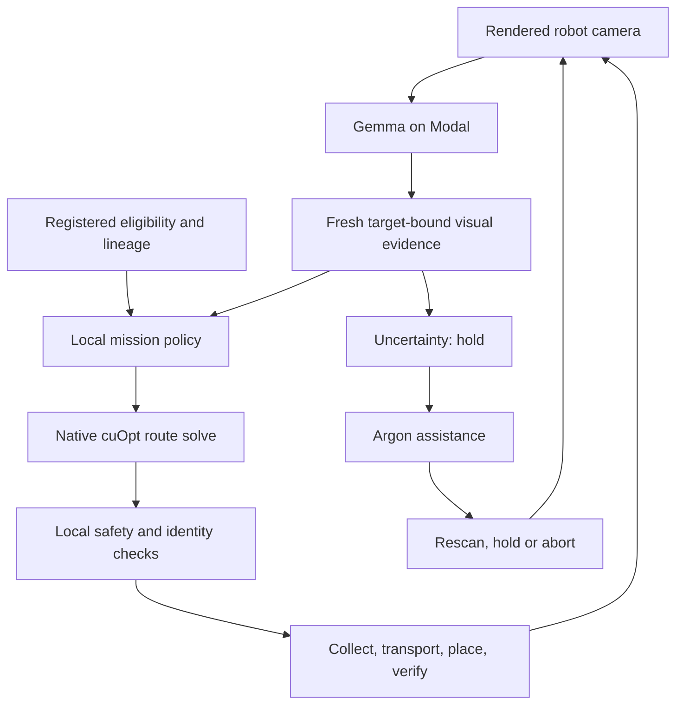

# Reef Rescue — Great Barrier Defenders

Reef Rescue is a robotics simulation prototype for moving **registered, already-detached coral fragments** onto eligible bleached recipients. It combines robot-camera perception with Gemma, bounded Gemini Argon assistance, NVIDIA cuOpt route selection and local motion/safety controls.

The **pipeline video** presents this workflow. For reproducible implementation and measured results, start with the [evidence index](docs/EVIDENCE.md), [scenario and failure cases](docs/SCENARIOS.md), [judging guide](docs/JUDGING_GUIDE.md) and [setup](SETUP.md).

## The scenario

A restoration team supplies the source/recipient registry: species, lineage and biological eligibility. The robot inspects the recipient and loose stock, collects a compatible fragment, transports it, places it and verifies mechanical attachment. It holds, rescans or aborts if evidence or conditions are unsafe. It never needs to cut a healthy colony in this workflow.

The compact demonstration uses a configured reef scene with one placement goal. Gemma examines rendered robot-camera pixels; it reports appearance, target visibility and fragment/gripper state. **RGB appearance does not establish viability or genotype.** Registry data and simulated UV exposure checks remain separate inputs. The simulation demonstrates mechanical handling, not biological recovery. The [scientific motivation and intended impact](docs/JUDGING_GUIDE.md#relevance-scientific-motivation-and-intended-impact) link to primary research and current reef monitoring.

## Models and their jobs

| Component | Exact identifier | Where it runs | Responsibility |
| --- | --- | --- | --- |
| Google Gemma | `gemma-4-E4B-it`, weights `google/gemma-4-E4B-it` | vLLM on Modal | Read robot-camera images and return structured visual evidence. |
| Google Gemini Argon | `gemini-4-argon` | Google Interactions API | Advise on held issues: `rescan`, `hold` or `abort`; optional post-mission review. |
| NVIDIA cuOpt | `nvidia-cuopt`; recorded solver `26.10.0` | Modal | Solve costs for proposed route alternatives. |
| Local mission policy | `reef-local-policy-v1` | Python gateway | Check fresh perception and registry eligibility, propose an action and route. |
| Local controller | Mission state machine and reduced physics | Browser | Enforce motion, clearance, current, grip, identity and placement checks. |

**Gemma is currently served through Modal.** On-robot Gemma is a deployment target; an onboard model, power budget or disconnected successful mission has not been measured. Configured GPU choices are not resource measurements. The current Modal deployment offers L4/A10 for Gemma and T4 for cuOpt.

The separate Python research stack defaults to `gemma-4-31b-it`. Its optional cloud perception client uses `gemini-3.5-flash-lite`; synthetic fixture generation uses `gemini-nano-banana-2.1`. These are not additional models in the recorded browser mission. See the [model-to-source map](docs/ARCHITECTURE.md).

## How a decision becomes action



Gemma packets carry target/capture IDs, timestamps and image hashes. Replayed, stale or mismatched evidence must not authorize handling. The controller continues safety/physics checks during remote waits. Argon receives structured observations and telemetry in the assistance operation; it cannot authorize handling, issue arbitrary actuator commands or automatically modify the code. A rescan still has to pass the original gates.

The independently displayed Isaac RTX camera/state feed is read-only. Browser mission execution uses its own controller and reduced physics; [architecture](docs/ARCHITECTURE.md) explains both integration paths.

## Recorded result and validation

The [complete saved live-model episode](docs/evidence/live-model-episode.json), exported **8 November 2026 at 13:41:14 UTC**, records:

- One mechanically verified placement; zero collisions, drops or recoveries, in 80.55 simulated seconds.
- Five Gemma responses; an uncertain observation triggered actual Argon assistance and a fresh rescan.
- A camera-dropout hold followed by recovery; one native cuOpt route solve.

| Measurement in that episode | Samples | Recorded value |
| --- | ---: | --- |
| Gemma browser request/response latency | 5 | 2.687–3.201 seconds |
| Argon assistance latency | 1 | 22.700 seconds |
| cuOpt solve time | 1 | 0.198 seconds |

These are observations from one run, not performance guarantees. Deterministic regression tests cover additional failures, including same-fragment drop recovery, stale perception, provider outages and unsafe routes. [SCENARIOS](docs/SCENARIOS.md) maps each case to its test; [EVIDENCE](docs/EVIDENCE.md) preserves provenance and distinguishes measurements from test coverage.

## Run and inspect

```bash
git clone https://github.com/tara-kas/great-barrier-defenders.git
cd great-barrier-defenders
python3 sim/pelagic/scripts/run_lab.py
```

Open `http://127.0.0.1:8090`. For real inference, configure the server-side model endpoints and credentials in [SETUP](SETUP.md), then use **Robot + base**. Starting the viewer alone does not provision inference services.

```bash
python3 tools/verify_submission.py
cd sim/pelagic
node --test tests/lab-*.test.mjs
python3 -m unittest tests.test_lab_server tests.test_live_feed tests.test_live_stream_capture
```

The tests use explicit fixtures/provider doubles and local HTTP servers. They require no paid inference. The separate Python stack has its own regression command in [SETUP](SETUP.md).

## Repository map

| Path | Contents |
| --- | --- |
| [sim/pelagic](sim/pelagic/README.md) | Current browser mission, camera, gateway, Modal serving, worker, simulation and tests. |
| [agent](agent/README.md), [mission](mission/README.md), [perception](perception/README.md) | Separate Python mission/perception research stack and adapters. |
| [cloud](cloud/README.md) | Standalone Argon log debrief and proposal validation. |
| [eval](eval/README.md), [dashboard](dashboard/README.md) | Research evaluation fixtures and log viewer. |
| [docs](docs/README.md) | Architecture, scenarios, judging answers, evidence and remaining acceptance work. |
| [AGENTS.md](AGENTS.md) | Starting instructions for repository reviewers and coding agents. |

[Implementation status](docs/IMPLEMENTATION_STATUS.md) lists the remaining concrete acceptance work: repeated live-model fault trials, calibrated perception, measured on-robot operation and physical/ecological validation. Passing software tests establishes the tested behavior, not a failure-free field robot.
